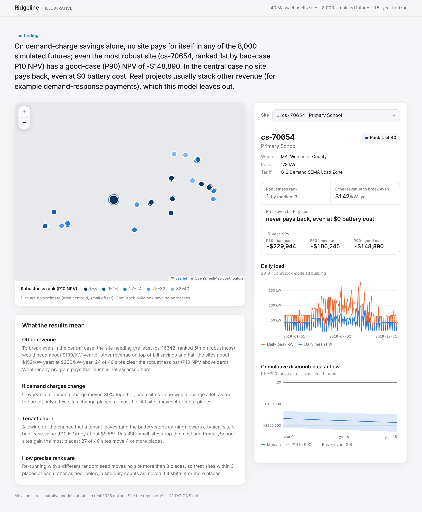

# Ridgeline

Ranks Massachusetts commercial sites for behind-the-meter battery peak shaving, by
**robustness under uncertainty**, not by expected value alone. For each of 40 real NREL ComStock
buildings it:
1. simulates a 125 kW / 250 kWh battery against the building's 15-minute load and a real
   demand-charge tariff (MECo G-2);
2. runs a 15-year Monte Carlo cash-flow model;
3. ranks sites by their bad-case (P10) NPV, with breakeven battery cost alongside;
4. explains in plain sentences what moves the ranking;
5. optionally uses an LLM to extract tariff parameters from text and to explain a site, with every
   output checked against its source before it is shown (M6).

> **All outputs are illustrative.** This is a personal project inspired by a real problem, not
> anyone's production model. Every number about the world is in `assumptions.yaml` with a source
> URL or the label `ASSUMPTION`.

**Current finding:** on demand-charge savings alone, no site pays back at NREL ATB 2026 battery
costs (about $1,570/kW), in any of 8,000 simulated futures, and none would even at $0 battery cost:
every site's yearly bill savings are below the battery's fixed O&M. The site needing the least
other revenue (cs-16342) would need about $139/kW-year (for example demand-response payments, not
modeled). Every site is billed on its real MECo tariff: G-2 up to 200 kW, G-3 time-of-use above
(2025 URDB rates). The ranking shows where a battery loses least, most reliably; G-2 sites take 8
of the top 10. Details: [`docs/m4_ranking.md`](docs/m4_ranking.md).



## Quickstart

Requires [uv](https://docs.astral.sh/uv/). Python 3.11 is installed by uv.

```bash
git clone https://github.com/Lkumar209/Ridgeline.git && cd Ridgeline
```

```bash
uv sync
```

```bash
make demo
```

`make demo` downloads ~30 MB of ComStock data, simulates and ranks the 40 sites (1–2 minutes
the first time), then serves the map at http://127.0.0.1:8000. The page loads Leaflet and OpenStreetMap tiles
from the internet.

Tests and checks need no network, API keys or downloaded data:

```bash
make check
```

GitHub Actions runs the same `make check` on every push and pull request.

## Commands

| Command | What it does |
|---|---|
| `uv run ridgeline fetch-data [--dev-subset]` | Select sites from ComStock metadata, cache loads, weather and the PUMA map; write `data/sites.csv` and `data/site_locations.csv` |
| `uv run ridgeline simulate [--dev-subset] [--tariff-override FILE]` | Dispatch and monthly bills for each site: practical controller, oracle threshold, perfect-foresight LP |
| `uv run ridgeline rank [--dev-subset] [--draws N] [--resimulate]` | 15-year Monte Carlo, robustness ranking, sensitivity, plain-language explanations |
| `uv run ridgeline serve` | FastAPI on http://127.0.0.1:8000: `/api/sites`, `/api/rankings`, `/api/sites/{id}`, and the map page |
| `uv run python scripts/report_ranking.py` | Regenerate `docs/m4/` from the latest `rank` run |
| `uv run ridgeline evals [--live]` | M6 eval set (11 cases): offline against a mock client, or a real model with `--live` |
| `uv run ridgeline extract-tariff FILE` | LLM tariff extraction with per-field confidence and quoted evidence (needs `ANTHROPIC_API_KEY`) |
| `uv run ridgeline explain SITE_ID` | LLM plain-language explanation of one site, grounded in `rank` outputs (needs `ANTHROPIC_API_KEY`) |

## Repo map

| Path | What |
|---|---|
| `src/ridgeline/data/` | Boundary schemas and loaders: ComStock, weather, tariffs (URDB JSON), sites, locations |
| `src/ridgeline/gaps/` | Meter-outage simulation and imputation (M2) |
| `src/ridgeline/battery/` | Battery model, threshold controller, LP upper bound, bill calculator (M3) |
| `src/ridgeline/scenarios/` | 15-year cash flow and Monte Carlo (M4) |
| `src/ridgeline/ranking/` | P10 ranking, breakeven, tornado, scenario sweeps, plain-language sentences (M4) |
| `src/ridgeline/api/`, `src/ridgeline/web/` | FastAPI app and the single Leaflet page (M5) |
| `src/ridgeline/agent/` | LLM client (Anthropic + mock), tariff extraction, explanations, validators, evals (M6) |
| `src/ridgeline/results.py` | Fingerprinted cache of simulated savings |
| `src/ridgeline/cli.py`, `config.py`, `assumptions.py` | CLI, run settings, sourced assumptions |
| `config/default.yaml`, `assumptions.yaml` | How to run; facts and ranges about the world |
| `data/sites.csv`, `data/site_locations.csv`, `data/tariffs/` | Committed site list, approximate locations, tariff files |
| `data/fixtures/`, `tests/fixtures/` | Small real-data and fake-tariff fixtures for offline tests |
| `tests/` | `unit/`, `property/` (hypothesis), `golden/`, `e2e/` |
| `docs/` | Architecture and the milestone write-ups (M2–M5), with figures and generated results |
| `scripts/`, `spikes/` | Fixture builder, experiment and report scripts; the M0 data spike |

## Documentation

- [`ONBOARDING.md`](ONBOARDING.md): the problem, the pipeline, each module, how to run, test and
  debug, what is most likely to break, and three starter features.
- [`docs/architecture.md`](docs/architecture.md): data-flow and module diagrams, plus contracts.
- [`DECISIONS.md`](DECISIONS.md): ADRs for key choices and rejected alternatives.
- [`LIMITATIONS.md`](LIMITATIONS.md): what is simplified or not modeled.
- [`AI_LOG.md`](AI_LOG.md): what AI generated each milestone, and what was wrong and how it was caught.
- Write-ups:
  - [M2 imputation](docs/m2_imputation.md)
  - [M3 dispatch and billing](docs/m3_dispatch.md)
  - [M4 ranking](docs/m4_ranking.md) (generated numbers in [`docs/m4/results.md`](docs/m4/results.md))

## Status

M0–M7 are done. The M6 agent layer passes its 11 evals offline (mock client) and live on
claude-opus-5-5 (11/11 after fixing two issues the first live run found; see `AI_LOG.md`). To run
it yourself, set `ANTHROPIC_API_KEY` (and optionally `RIDGELINE_LLM_MODEL`) and run
`uv run ridgeline evals --live`. A run costs well under $1.
