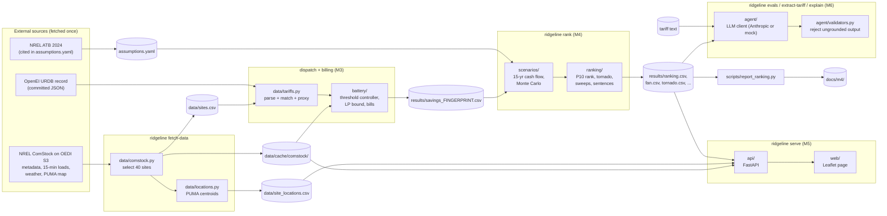
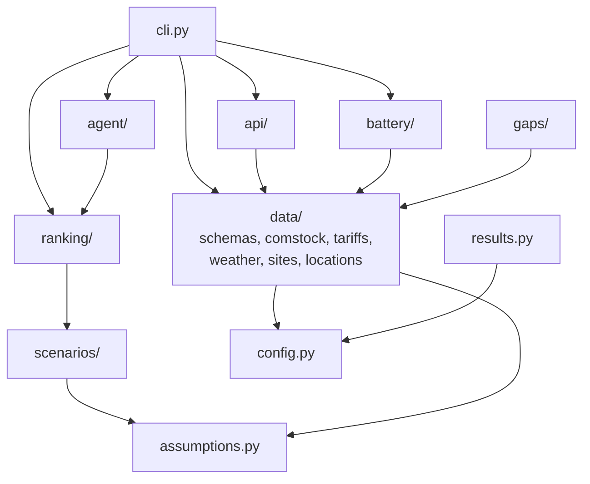

# Architecture

Ridgeline is a batch pipeline with a thin read-only web layer on top. Each stage writes files
the next stage reads, so any stage can be re-run, inspected or tested on its own.

## Data flow

`results/` is `data/cache/results/` (gitignored). `docs/m4/` holds a committed copy for readers.

## Module dependencies

Arrows point from a module to what it imports. Nothing imports `cli.py`, `api/` or `agent/`;
`agent/` imports the Anthropic SDK only inside `AnthropicClient`. The core
(`battery/`, `scenarios/`, `ranking/`) is pure functions over numpy and pandas plus pydantic models:
no network and no file I/O. I/O lives in `data/`, `results.py`, `api/data.py` and `cli.py`.

## Boundaries and contracts

| Boundary | Contract | Where it is enforced |
|---|---|---|
| Raw data → everything | `Site`, `LoadProfile`, `Tariff`, `BatterySpec` pydantic models | `data/schemas.py` |
| Numbers → code | Every value has a source URL or `ASSUMPTION`; ranges bracket the value | `assumptions.py`, `tests/unit/test_config_and_assumptions.py` |
| Timestamps | UTC interval-start internally; tariffs in America/New_York | `data/timestamps.py` (ADR-003) |
| Simulation → Monte Carlo | Savings table, cached under a fingerprint of all its inputs | `results.py` |
| Monte Carlo → web | CSV and JSON files written by `rank`; API never recomputes | `api/data.py` |
| API → page | Pydantic response models | `api/models.py` |
| LLM → anything shown | Structured output schema; every value quoted from the source, every number from the facts | `agent/validators.py` (ADR-014) |
