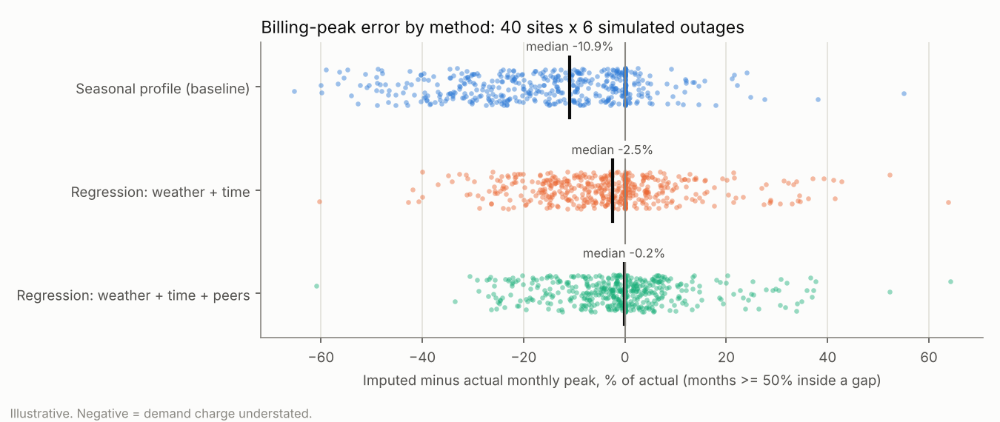
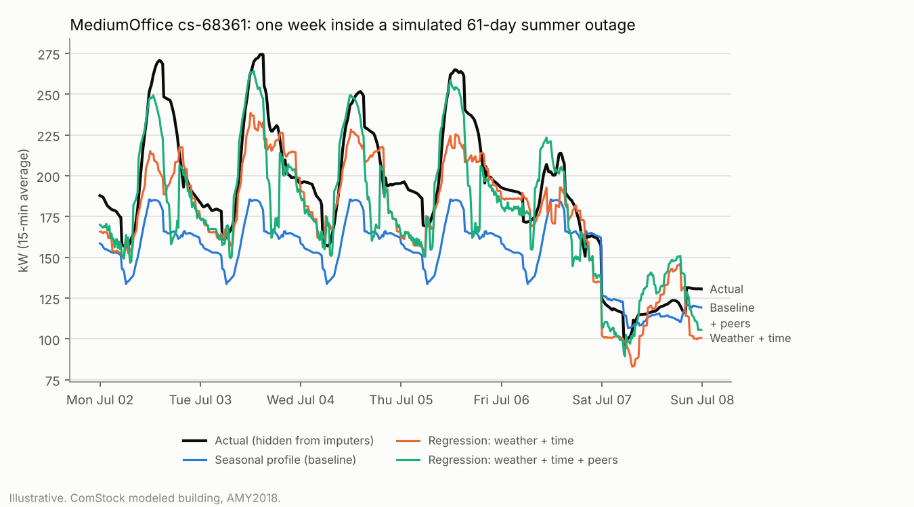

# M2: meter gaps and imputation

**Question.** Utility interval data often has 1–3 month holes. If we fill them, how wrong are the
filled months? And how wrong is the thing we actually bill on, each month's peak kW?

**Answer (illustrative, ComStock modeled buildings).** A simple seasonal-profile fill
understates billing peaks: in half the affected months it is off by 12% or more, and its average
bias is −14%. The bias is worst in summer. A weather-aware regression halves the typical peak
error (6%) and cuts the bias to about −4%. The tail is still fat: with the regression, 1 month
in 10 is off by 27% or more. That spread is what M4 should carry as uncertainty for any site with imputed
months.

## Setup

> **Site list note.** These results use the original 40 sites. In M3, 5 NSTAR sites were
> replaced (DECISIONS.md ADR-010). Rerun `scripts/evaluate_imputation.py` and
> `scripts/plot_imputation.py` to refresh.

- **Data:** all 40 selected sites, one real ComStock year each (15-min, AMY2018).
- **Gaps:** 6 per site, seeded (`gaps.seed = 7`). Lengths are 30–92 days (mean 62), and they start at a
  random 15-min interval. That makes 240 gaps, and 497 billing months that are at least 50% inside a gap.
- **Scoring:** the true data is hidden, each method fills it, and we compare against the truth.
- **Reproduce:** `uv run ridgeline fetch-data && uv run python scripts/evaluate_imputation.py &&
  uv run python scripts/plot_imputation.py`. The experiment takes about 65 s for 40 sites, or
  `--dev-subset` scores the 10 dev sites.

## Methods

| Method | What it does | Why |
|---|---|---|
| `seasonal_profile` (baseline) | For each gap, average the site's own load by (weekday/weekend, 15-min slot) over the 28 days before and after, and repeat that profile. | It is the obvious first thing anyone would do, and fully explainable. |
| `regression_weather` | Ridge least squares fit on the site's observed months: 192 (weekday/weekend × 15-min slot) dummies, plus cooling and heating degree terms (18 °C / 10 °C hinges), plain and × occupied hours. | Adds what the baseline can't see: temperature-driven HVAC load. |
| `regression_weather_peers` | The same, plus one column: the mean normalized load of the other same-type sites at the same instant. | "Similar sites", which can capture shared weather and schedule effects that the degree terms miss. |

All of these are plain numpy with no ML dependency (DECISIONS.md ADR-007).

## Results

All 240 gaps. Peak metrics use months at least 50% inside a gap. Signed error = imputed − actual.

| Method | MAE (kW, median) | MAPE (%, median) | Peak abs error (%, median) | Peak abs error (%, P90) | Peak bias (%, mean) |
|---|---|---|---|---|---|
| seasonal_profile | 11.1 | 16.5 | 11.9 | 40.8 | −14.0 |
| regression_weather | 8.9 | 15.7 | 6.0 | 26.6 | −4.4 |
| regression_weather_peers | 8.2 | 14.4 | 6.4 | 23.5 | −1.7 |

**Interval accuracy barely moves; peak accuracy moves a lot.** MAPE improves only from 16.5% to
14.4%, but the baseline's peak error is twice the regression's. A method chosen by MAE alone
would look nearly as good as the others and still be wrong where the money is.

**The baseline underestimates peaks, and summer is where it hurts.**

| Months | Baseline | Regression | Regression + peers |
|---|---|---|---|
| Summer (Jun–Sep), abs error % median | 20.7 | 6.5 | 5.2 |
| Summer, mean bias % | −20.1 | −5.3 | −1.6 |
| Other months, abs error % median | 8.6 | 5.6 | 6.6 |
| Other months, mean bias % | −9.7 | −3.8 | −1.8 |

A summer gap gets filled with May and September days, so cooling peaks vanish (see the example
below). Peak shaving is worth the most in exactly those months.

**By building type** (peak abs error %, median):

| Type | Baseline | Regression | + peers |
|---|---|---|---|
| Warehouse | 3.3 | 2.2 | 2.7 |
| FullServiceRestaurant | 9.5 | 3.3 | 3.7 |
| MediumOffice | 8.2 | 4.4 | 5.2 |
| Outpatient | 12.3 | 4.5 | 6.7 |
| RetailStandalone | 15.4 | 7.9 | 9.1 |
| SecondarySchool | 23.5 | 11.4 | 9.8 |
| PrimarySchool | 20.2 | 12.9 | 10.1 |
| RetailStripmall | 18.1 | 13.1 | 12.1 |

Schools are hardest: summer break and the academic calendar are not in the features. Peers
help there, because the peer schools share the calendar.

## What this means for demand charges

- The error flows straight into the bill. A demand charge is `rate × monthly peak kW`, so a −14%
  peak bias means the baseline understates that month's demand charge by about 14%. It also
  understates the battery's shaving opportunity in that month. The median absolute miss is 18 kW
  (baseline) against 11 kW (regression), next to a 125 kW battery.
- **Dollars come in M3.** Converting kW to $ needs the real tariff files. We don't invent a $/kW
  rate (principle 2). M3 will re-run this table in $/month per site.
- **Uncertainty to carry forward:** the signed peak error of `regression_weather` has P10/P90 of
  −23.5% / +8.4% per affected month. M4 should sample from this empirical distribution for
  imputed months. It should not treat filled data as known.

## Choice and caveats

- **Default imputer: `regression_weather`.** The peer variant has lower bias and a better P90, but a
  slightly worse median outside summer. Its advantage is also probably *inflated* here: ComStock
  buildings of one type share prototype schedules, so peers move together far more tightly than
  real neighbors do (LIMITATIONS.md). The peer variant stays available, and we can revisit it on
  real meter data.
- **Resolution matters.** The first version used *hourly* time dummies. Switching to 15-min slots,
  which matches the data, improved peak bias from −6.1% to −4.4% for the plain regression (and from
  −2.8% to −1.7% with peers), and lowered MAE. The median absolute peak error with peers went
  slightly up (5.6% to 6.4%). Both runs are reported, nothing was tuned further, and the
  change was made because the resolution should match the data, not to chase this test set.
- **Clean gaps only.** Gaps here are whole-meter outages in otherwise clean modeled data. Real
  outages may cluster (storms), come with partial data, or affect peers at the same time.
- **Calendar months** stand in for billing cycles.
