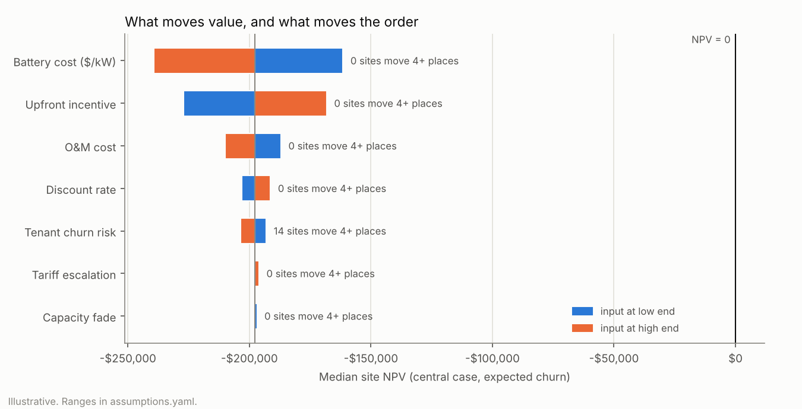

# M4 results (generated)

Generated by `scripts/report_ranking.py` from `ridgeline rank` (8,000 draws, seed 2026). Do not edit by hand.
All values illustrative; real 2025 dollars.

## In plain language

- **Headline.** On demand-charge savings alone, no site pays for itself in any of the 8,000 simulated futures; even the most robust site (cs-70654, ranked 1st by bad-case P10 NPV) has a good-case (P90) NPV of -$148,890. In the central case no site pays back, even at $0 battery cost. Real projects usually stack other revenue (for example demand-response payments), which this model leaves out.
- **Other revenue.** To break even in the central case, the site needing the least (cs-16342, ranked 5th on robustness) would need about $139/kW-year of other revenue on top of bill savings and half the sites about $152/kW-year; at $200/kW-year, 24 of 40 sites clear the robustness bar (P10 NPV above zero). Whether any program pays that much is not assessed here.
- **Closeness.** The sites are close together: neighbours in the ranking differ by a median $358 of bad-case value, so small input changes can swap neighbours without changing the overall picture.
- **Rank stability.** Re-running with a different random seed moves no site more than 3 places, so treat sites within 3 places of each other as tied; below, a site only counts as moved if it shifts 4 or more places.
- **All demand.** If every site's demand charge moved 30% together, each site's value would change a lot; as for the order, only a few sites change places: at most 1 of 40 sites moves 4 or more places.
- **Tenant churn.** Allowing for the chance that a tenant leaves (and the battery stops earning) lowers a typical site's bad-case value (P10 NPV) by about $9,581. RetailStripmall sites drop the most and PrimarySchool sites gain the most places; 27 of 40 sites move 4 or more places.

## Top 10 by robustness (P10 NPV)

| Rank | Site | Type | Proxy tariff | P10 NPV | P50 NPV | P90 NPV | Rank by P50 | Breakeven battery cost | Other revenue needed $/kW-yr |
|---|---|---|---|---|---|---|---|---|---|
| 1 | cs-70654 | PrimarySchool | no | -$229,944 | -$186,245 | -$148,890 | 3 | never pays back, even at $0 battery cost | $142 |
| 2 | cs-130562 | Outpatient | no | -$230,203 | -$183,629 | -$142,802 | 1 | never pays back, even at $0 battery cost | $139 |
| 3 | cs-144167 | SecondarySchool | no | -$233,763 | -$190,225 | -$153,974 | 5 | never pays back, even at $0 battery cost | $146 |
| 4 | cs-98720 | Outpatient | no | -$234,054 | -$187,130 | -$148,594 | 4 | never pays back, even at $0 battery cost | $143 |
| 5 | cs-16342 | RetailStandalone | no | -$234,462 | -$184,203 | -$138,851 | 2 | never pays back, even at $0 battery cost | $139 |
| 6 | cs-67046 | SecondarySchool | no | -$234,627 | -$190,623 | -$154,416 | 6 | never pays back, even at $0 battery cost | $146 |
| 7 | cs-106921 | SecondarySchool | no | -$237,031 | -$193,592 | -$157,001 | 9 | never pays back, even at $0 battery cost | $148 |
| 8 | cs-39283 | SecondarySchool | no | -$238,495 | -$195,582 | -$159,062 | 11 | never pays back, even at $0 battery cost | $150 |
| 9 | cs-36166 | PrimarySchool | no | -$238,853 | -$195,107 | -$159,222 | 10 | never pays back, even at $0 battery cost | $150 |
| 10 | cs-76304 | MediumOffice | no | -$239,871 | -$193,527 | -$153,982 | 8 | never pays back, even at $0 battery cost | $147 |

Full table: [`ranking.csv`](ranking.csv).

## What if sites also earned other revenue?

Every site gets the same extra $/kW-year (for example demand-response payments, which
this model does not include). No program amount is assumed; this only shows how much
would be needed.

| Other revenue $/kW-yr | Sites likely viable (P50 > 0) | Sites robustly viable (P10 > 0) |
|---|---|---|
| $0 | 0 | 0 |
| $25 | 0 | 0 |
| $50 | 0 | 0 |
| $75 | 0 | 0 |
| $100 | 0 | 0 |
| $150 | 4 | 0 |
| $200 | 40 | 24 |

## Sensitivity: tornado (one input at a time)

| Input | Low | High | Median NPV at low | Median NPV at high | Median swing | Sites moving 4+ places |
|---|---|---|---|---|---|---|
| Battery cost ($/kW) | 1230.09 | 1962.43 | -$161,490 | -$239,302 | $77,812 | 0 |
| Upfront incentive | 0 | 0.3 | -$227,090 | -$168,201 | $58,889 | 0 |
| O&M cost | 29.645 | 47.289 | -$187,013 | -$209,905 | $22,892 | 0 |
| Discount rate | 0.03 | 0.08 | -$203,079 | -$191,324 | $11,320 | 0 |
| Tenant churn risk | 0.5 | 2 | -$193,064 | -$203,697 | $7,359 | 14 |
| Tariff escalation | -0.01 | 0.02 | -$198,341 | -$196,035 | $2,539 | 0 |
| Capacity fade | 0.01 | 0.03 | -$196,890 | -$198,355 | $1,669 | 0 |

## Scenario comparisons (full Monte Carlo, same random draws)

| Comparison | Spearman | Counts as moved at | Sites moved | Largest move | Top 10 kept |
|---|---|---|---|---|---|
| all_demand_x0.7 | 0.995 | 4+ places | 1 | 5 | 10 |
| all_demand_x1.3 | 0.995 | 4+ places | 0 | 3 | 10 |
| churn_on_vs_off | 0.622 | 4+ places | 27 | 21 | 4 |
| seed_stability | 0.996 | 3+ places | 1 | 3 | 10 |

## Median rank by building type

| Type | Median rank |
|---|---|
| SecondarySchool | 7 |
| Outpatient | 13 |
| PrimarySchool | 14 |
| MediumOffice | 17 |
| RetailStandalone | 21 |
| RetailStripmall | 22 |
| Warehouse | 28 |
| FullServiceRestaurant | 37 |
