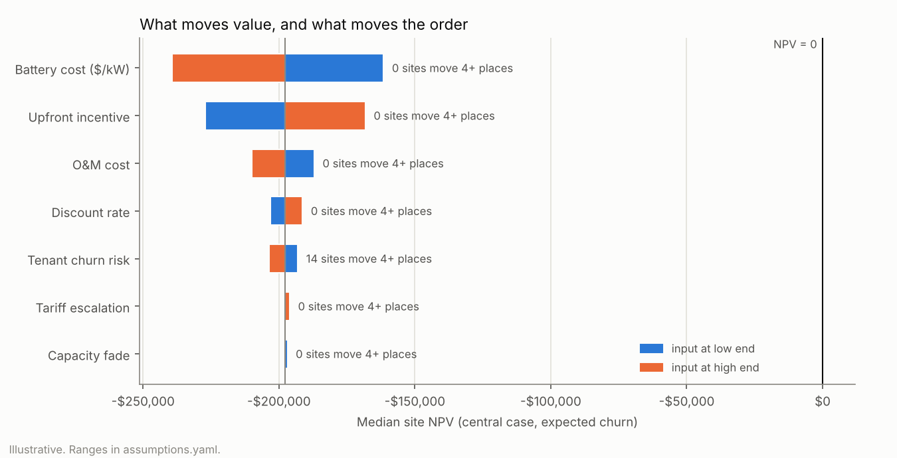

# M4: 15-year Monte Carlo and robustness ranking

All numbers come from `docs/m4/results.md`, which is generated from `ridgeline rank` by
`scripts/report_ranking.py`. Everything is **illustrative**, in real 2025 dollars.

## The answer, in plain language

- **No site is viable on demand-charge savings alone.** Real projects usually stack other revenue
  (for example demand-response program payments), which this model leaves out on purpose; see
  "Incentives and other revenue" below.
  - At NREL ATB 2026 costs for a 2-hour commercial battery (central $1,570/kW in 2025$, about
    $196k for 125 kW), with MECo G-2 delivery rates and the practical controller, only 1 of 40
    sites has a positive NPV in even one of 8,000 simulated futures.
  - **Breakeven battery cost is the clearest number.** The site closest to breaking even is
    cs-118913 (best by median NPV, but ranked 6th on robustness because of its high tenant churn).
    In the central case it breaks even only if the battery cost about **$56/kW**.
  - **The other 39 never pay back, even at $0 battery cost,** because their yearly bill savings are
    smaller than the ~$4.7k/yr fixed O&M. The most robust site (cs-144167, ranked 1st on P10 NPV)
    is one of them; it simply loses least, most reliably.
- **How much other revenue would it take?** About **$124/kW-year** for the site needing the least
  (cs-118913) and $147 for the median site, on top of bill savings, to break even in the central case. At $200/kW-year,
  31 of 40 sites clear the robustness bar (P10 NPV above zero). Whether any program pays that much
  is not assessed here.
- **So the ranking answers "where would a battery hurt least, most reliably"** on bill savings alone.
  That is still the right input to a decision about incentives, cheaper hardware, stacked revenue,
  or a better controller.
- **Tariff sensitivity, what it means:** even if our stand-in price for the 23 large buildings is off
  by 30%, most of the same sites stay near the top (7–8 of the top 10). The middle of the list
  reshuffles, though, so trust the top group, not exact positions.
- **Tenant churn, what it means:** buildings whose tenants come and go (strip malls, restaurants) are
  riskier homes for a battery than schools and clinics. That risk reorders the list more than
  anything else we tested.

## Incentives and other revenue: what is and is not included

| Item | In the model? | How |
|---|---|---|
| Upfront, capex-reducing incentives (for example a federal investment tax credit for storage, if a project qualifies) | Yes, as one generic input | `upfront_incentive_fraction`: 0–30% of capex, central 15%, ASSUMPTION. No program's eligibility or rate is asserted. |
| Recurring performance payments (for example Mass Save ConnectedSolutions demand-response payments) | **No** | Reported instead as the **other revenue each site would need** to break even (`required_other_revenue_usd_per_kw_year`), and a viability table over a sweep of revenue levels ($0–200/kW-year). No amount is guessed. |
| Wholesale market, capacity or export revenue | No | Out of scope (LIMITATIONS.md). |

The other-revenue figures assume the revenue is earned every year of the 15-year life, whether or
not the tenant stays. They use the central discount rate (the sweep uses each draw's own rate).

## Method

1. **Year-1 savings per site** come from M3. The practical controller (no lookahead) is simulated on
   G-2 or the labeled proxy, and its savings are split into demand-charge and energy parts
   (`battery/simulate.py`). Simulation takes about 35 s for 40 sites and is cached under a
   fingerprint of its inputs (`results.py`).
2. **15-year cash flow** (`scenarios/cashflow.py`), per site, per draw, per year:
   - savings = (proxy multiplier × demand + energy) × escalation^(t−1) × (1 − fade)^(t−1) × noise;
   - counted only while the tenant stays;
   - minus fixed O&M (which continues after the tenant leaves);
   - discounted, minus capex net of the upfront incentive.
3. **Uncertainty** (`scenarios/montecarlo.py`): every range below is drawn uniformly. The global
   draws are shared by all sites, so differences come from the sites, not sampling luck. Churn is
   a per-site departure year drawn from the building type's hazard × the churn multiplier.
   Savings noise is lognormal with mean 1.
4. **Ranking** (`ranking/metrics.py`):
   - **Robustness score = P10 NPV**: "in 9 of 10 futures the site does at least this well".
   - Ranked by that score, with P50 shown alongside for contrast.
   - **Breakeven capex ($/kW)** is the main companion metric, since almost every NPV is negative.
     The ranking orders sites almost the same way (Spearman 0.94).
   - Also reported: P(NPV>0) and the other revenue needed to break even.
5. **Sensitivity** (`ranking/sensitivity.py`):
   - **Tornado:** one input at a time to its low and high end.
   - **Proxy demand charge:** pinned at 0.7 and 1.3 for the 23 proxy sites, with an all-sites
     contrast.
   - **Churn:** switched off.
   - **Seed check:** a second random seed, to measure Monte Carlo noise.

| Input | Range | Source |
|---|---|---|
| Battery capex | $1,118–1,784/kW (2022$), central $1,428 | NREL ATB 2024 v3, commercial 2-hour battery, 2026 |
| Fixed O&M | $26.9–43.0/kW-yr (2022$), central $34.4 | same |
| 2022$ → 2025$ | × 1.10 | ASSUMPTION |
| Real discount rate | 3–8%, central 5% | ASSUMPTION |
| Real tariff escalation | −1% to +2%/yr, central 0% | ASSUMPTION |
| Upfront incentive | 0–30% of capex, central 15% | ASSUMPTION |
| Capacity fade | 1–3%/yr, central 2% | ASSUMPTION |
| Proxy demand charge | × 0.7–1.3 (proxy sites only) | ASSUMPTION (project owner) |
| Tenant churn | 1–12%/yr by type, × 0.5–2 | ASSUMPTION |
| Year-to-year savings noise | 10% sd | ASSUMPTION |

## Results

**Top of the list (P10 NPV):**
- **Secondary schools and outpatient clinics lead.** Their median ranks are 5 and 9; restaurants
  are last (median 38).
- **Robustness and the average disagree.** cs-118913 (a strip mall) has the best *median* NPV and
  the only positive draw, but ranks 6th on robustness: its high tenant churn makes its bad cases bad.
- **Low-churn sites rise.** A low-churn school ranked 10th by median (cs-70654) rises to 3rd.

**What moves value vs what moves the order** (tornado, `docs/m4/tornado.png`):



- **Cost inputs move every site together.** Battery cost (swing ~$78k), the incentive (~$59k)
  and O&M (~$23k) move the order by **zero** places, because every site carries the same battery.
  They decide *whether* batteries pay, not *where*.
- **Two inputs reorder sites.** In the one-at-a-time tornado, tenant churn moves 15 sites by 5+
  places and the proxy demand charge moves 26.

**Scenario comparisons** (full Monte Carlo, same draws):

| Change | Sites moving 5+ places | Top 10 kept |
|---|---|---|
| Proxy demand charge × 0.7 | 15 | 7 |
| Proxy demand charge × 1.3 | 9 | 8 |
| Every site's demand charge × 0.7 | 1 | 9 |
| Every site's demand charge × 1.3 | 0 | 9 |
| Churn switched off | 24 | 3 |

**How precise is a rank?** The sites are tightly packed: neighbors differ by a median $329 of P10
NPV. A second random seed moves sites by up to 4 places, so ranks within 4 places are effectively
tied. "Moved" is counted only at 5+ places, which is above that noise. The scenario comparisons reuse
the same draws, so their shifts are caused by the change, not by sampling.

**Runtime budget:** under 5 s for the Monte Carlo and all sensitivity runs (measured ~3 s: 40 sites
× 8,000 draws × 15 years, plus 6 re-runs and the tornado). Simulating savings takes ~35 s and is
cached. 8,000 draws were chosen because the seed-to-seed P10 noise falls from ~$1,900 at 2,000 draws
to ~$300 (it is ~$140 at 32,000 draws, which take ~3.5 s each).

## Reproduce

```bash
uv run ridgeline fetch-data
```

```bash
uv run ridgeline rank
```

```bash
uv run python scripts/report_ranking.py
```

## Caveats (see LIMITATIONS.md)

- **The practical controller leaves money on the table.** With perfect foresight, dev-subset savings
  are a median 2× higher (range 1.6–3.6×, M3), enough to cover O&M at 9 of those 10 sites. Better
  threshold forecasting is the biggest lever on viability.
- **Delivery-only bills** exclude supply, so losses and arbitrage are under-valued.
- **Savings scale linearly with remaining capacity**, and there is no augmentation.
- **Churn hazards are relative guesses by building type.** When a tenant leaves, savings stop for good.
- **Incentives are a single generic upfront fraction**, not modeled program by program.
- **Imputation error (M2)** is not added, because the 40 sites have no real meter gaps.
